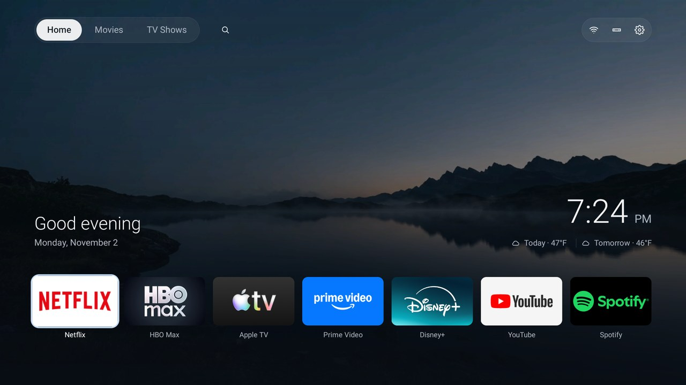
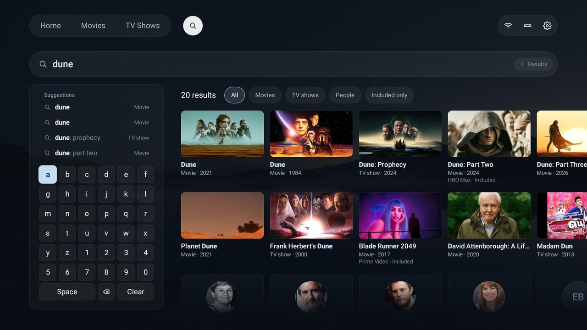
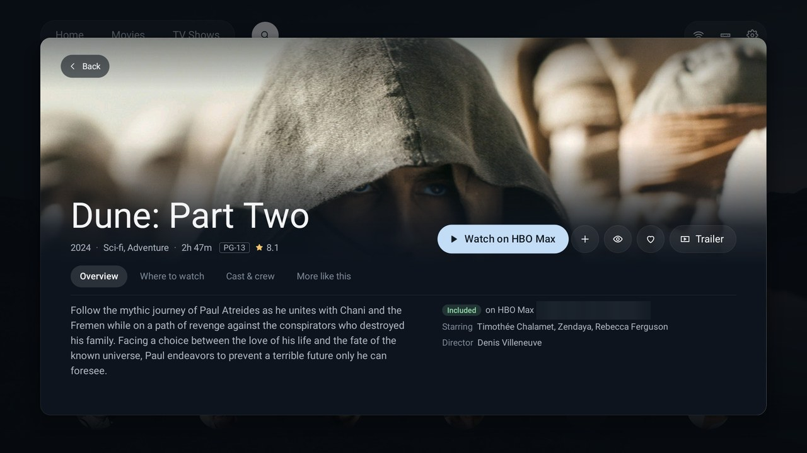
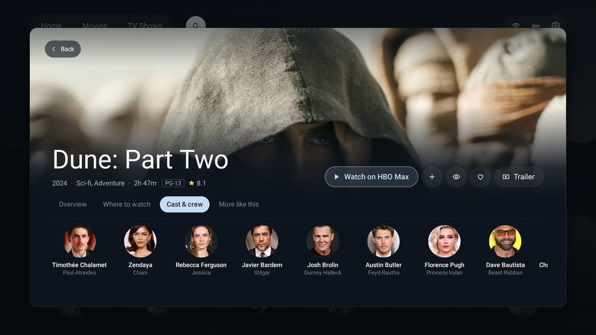
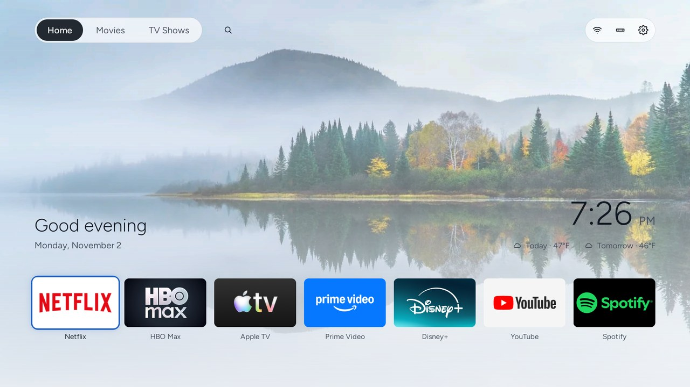
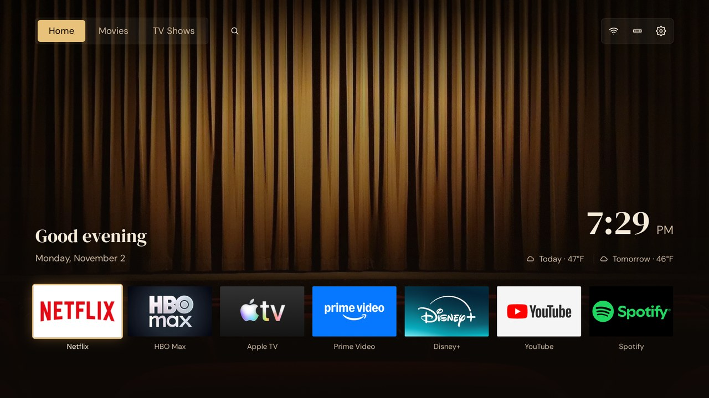
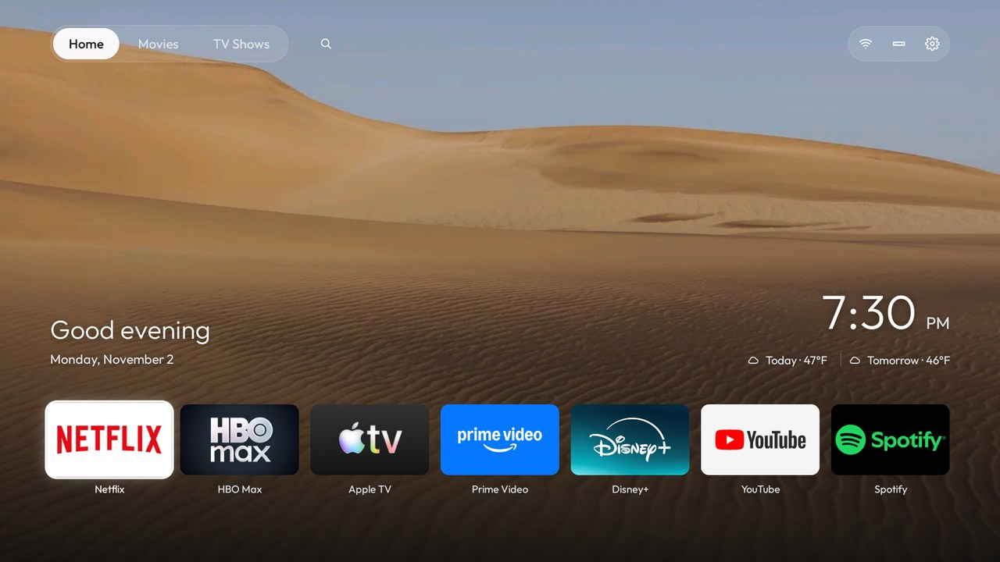
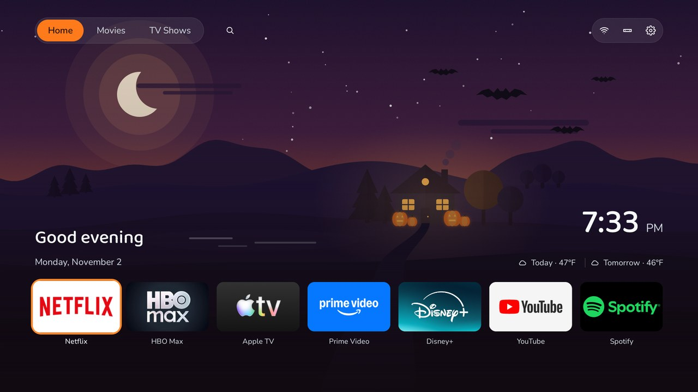
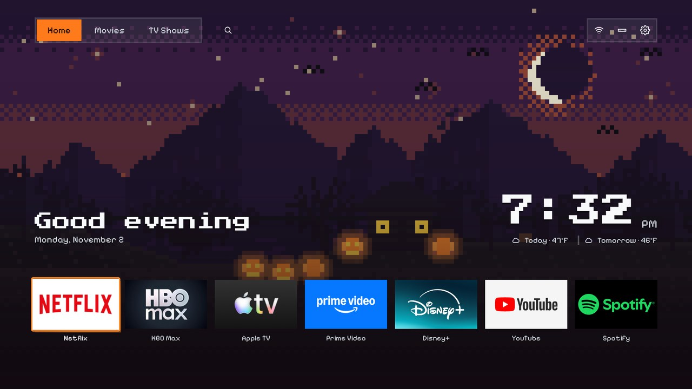

# HomeTV Launcher

A home screen for Android TV that you drive with the remote. Your apps and inputs are up front, and your household's
movies and shows are one press away, with the services that have them, a title preview, search, Pick for me and the
weather. No ads and no analytics, and Home works with the network off.

**[Try it in your browser](https://rebeccamcfadden.github.io/hometv-launcher/demo/)**: the keyboard stands in for the remote.
**[Put it on your TV](https://rebeccamcfadden.github.io/hometv-launcher/)**: a simple install guide, for a Windows laptop.

| | |
|---|---|
|  |  |
| *Home: greeting, clock, weather and your apps* | *Search: typo-tolerant, results as you type* |
|  |  |
| *Title preview: Watch on your service, My list, Seen, Favorite, Trailer* | *Its tabs: where to watch, cast and crew, more like this* |

*Screenshots from a TCL TV (Android 9).*

## Themes

Eight built-in themes, chosen on the TV in Launcher settings › Theme. The Seasonal ones follow the date through ten
periods and their pictures follow the sun; these show the Halloween period at night. [All eight, and how they
work](themes/README.md).

| | | |
|---|---|---|
|  |  |  |
| *Midnight, the default* | *Daylight* | *Cinema* |
|  |  |  |
| *Landscapes* | *Vector art (Seasonal)* | *8-bit (Seasonal)* |

## What it connects to

Only the services below, and only for what the table says. Nothing else leaves the TV: no analytics, telemetry or
ads, and no accounts except the free ones whose API keys you choose to enter (TMDB, and Watchmode or Movie of the
Night for prices). What it downloads (catalogue, artwork, forecast, ids, prices, fonts, pictures) is kept on the TV,
so what was seen once still shows offline, and Home never waits for the network. Apart from checking a key you
enter, a feature switched off in Launcher settings › Features makes none of its calls.

| Service | What for | When |
|---|---|---|
| [TMDB](https://www.themoviedb.org) (`api.themoviedb.org`, `image.tmdb.org`) | Movies, TV Shows, Search, title previews, artwork, signing in, your TMDB lists (Phone notes included) | With a TMDB key and the TMDB account feature on |
| [Open-Meteo](https://open-meteo.com) (forecast and geocoding) | The weather; finding a place in Launcher settings › Weather | With Weather on: when Home or Launcher settings › Weather shows and the forecast is over 30 minutes old; a place search as you search |
| [Wikidata](https://www.wikidata.org) (`query.wikidata.org`) | The services' own ids for a title, so Watch opens it in the app, and Apple's store ids | When a title preview opens; with Price lookup on and an account signed in, also in the background for titles on your lists that are for rent or sale. Kept a month |
| Apple's iTunes Search API | Apple TV Store rent and buy prices | With Price lookup on, for a title that is for rent or sale, when the keyed sources below didn't price Apple's store |
| [Watchmode](https://www.watchmode.com), [Movie of the Night](https://www.movieofthenight.com) | Other stores' rent and buy prices (Movie of the Night only when Watchmode had none); Watchmode's free quota check and Movie of the Night's list of changed titles, each at most once a day | With your own key for each and Price lookup on: prices for a title that is for rent or sale, the change list when Home shows |
| Google Fonts (Play services' font provider, else `fonts.googleapis.com` and `fonts.gstatic.com`) | A theme's fonts | Once per font, unless Typeface is System font |
| jsDelivr (this repository's [`launcher/backdrops/`](launcher/backdrops/README.md)) | The pictures of themes that have one | Once per picture, unless Performance's picture is Plain colour |
| TMDB, Watchmode, Movie of the Night | Checking an API key: one free request with it (`/authentication`, `/regions`, `/countries`) | When you enter or re-check a key, and when the TV couldn't reach the service last time; whatever Features says |
| [GitHub Releases](https://github.com/rebeccamcfadden/hometv-launcher/releases) (`github.com` and its download host) | In-app updates: the latest release's `version.json`, and the new APK | Only in a release build from `tools/release.ps1`, with Launcher settings › About › Check for updates on: `version.json` once a day while Home shows; the APK only when you press Install update |

Phone notes, the API key page and the phone remote are served on your home network by the TV itself; they don't go
through the internet. The phone remote (HTTPS on port 8767, or the next free one up to 8770, with a certificate the TV
makes) listens only while Phone remote is on, and acts only for a phone that paired with the code the TV shows.
## Install

**The install guide (start here):** [rebeccamcfadden.github.io/hometv-launcher](https://rebeccamcfadden.github.io/hometv-launcher/)
walks you through it from a Windows laptop on the same Wi-Fi as the TV: switch on Developer options, download one
installer, answer its questions. It backs up the TV, installs the launcher, makes it Home and helps you switch
debugging off again. About fifteen minutes, and every step can be undone.

**Or with a coding assistant:** on any computer on the same Wi-Fi, with this repo cloned, paste [PROMPT.md](PROMPT.md)
into Claude Code, [Codex](https://github.com/openai/codex), [Gemini CLI](https://github.com/google-gemini/gemini-cli)
or another coding assistant with shell access, and fill in your TV model. It backs up the TV, disables the
manufacturer's bloat (nothing is uninstalled, and one command puts it back), builds the launcher, makes it Home and
checks each step with screenshots from the TV. First, on the TV: Settings → Device Preferences → About → press OK on
**Build** seven times → back → Developer options → **USB debugging** on (and Network/ADB debugging if you see it).

Either way it needs Android 8.0 or newer. Fire TV keeps its own home screen (the debloat half still works), and
Samsung Tizen and LG webOS are different systems: [supported TVs](docs/supported-tvs.md).

## Documentation

| | |
|---|---|
| [The launcher](docs/launcher.md) | What each screen does, Launcher settings, themes, remote keys, building it yourself and its config |
| [Supported TVs](docs/supported-tvs.md) | What works where, and the tested debloat list for each model, in [`examples/`](examples/) |
| [Doing it by hand](docs/tools.md) | The scripts and tools without an assistant, and how they protect Home |
| [Restoring and updates](docs/restore.md) | One line puts the TV back; what to do after a firmware update or when something goes wrong |
| [Questions people ask](docs/faq.md) | Is it safe, firmware updates, closing ADB, blocking ads, going online |
| [Troubleshooting](docs/TROUBLESHOOTING.md) | Everything that bit us, by symptom |
| [Phone notes](docs/phone-notes.md), [Phone remote](docs/phone-remote.md), [Themes](themes/README.md), [Another home](docs/REMOTE.md), [The microphone](docs/microphone.md) | Send a watch-list note from a phone, a phone as remote and keyboard, the eight themes, helping someone remotely, what can be said about listening |

## Build and contribute

```sh
cd design_preview && npm install && npm run dev    # the web prototype, the spec for flows and behaviour
```

```sh
cd launcher && ./gradlew --no-daemon testReleaseUnitTest lintRelease assembleRelease
```

The launcher needs JDK 17 and Android SDK platform 34. Start with [AGENTS.md](AGENTS.md) (it is for people too) and
[docs/rework.md](docs/rework.md), which hold the rules, decisions and workflow; [BACKLOG.md](BACKLOG.md) lists what is
mocked or deferred, and [CONTRIBUTING.md](CONTRIBUTING.md) how to add your TV's list. Security problems are reported
privately: [SECURITY.md](SECURITY.md).

## Credits

HomeTV Launcher is a fork of [CleanYourTV](https://github.com/Gathin23/cleanyourtv) by Gathin and its contributors
(MIT). The debloat tools, the TV lists and the safety rules are theirs; so is the project's story, its press and its
community, which you will find in [their README](https://github.com/Gathin23/cleanyourtv#readme). The network features
draw on [cleanyourtv-ui](https://github.com/matheus-caldeira/cleanyourtv-ui) (MIT, with code from Free My TV, also
MIT); a file adapted from it says so at the top. This product uses the TMDB API but is not endorsed or certified by
TMDB.

## Legal

- This is an independent open-source project. It is not affiliated with, endorsed by or sponsored by any TV maker or
  platform. Brand and model names are used only to say which TV a list was tested on, and remain the trademarks of
  their owners.
- It works only through settings the TV itself offers to its owner: Developer options, ADB debugging and Android's own
  `pm disable-user`, the same switch as Settings > Apps > Disable. It does not root the TV, flash firmware, or bypass
  any lock, DRM or copy protection, and the repo contains no manufacturer software, firmware or APKs.
- Nothing is uninstalled, and `tools/restore.sh` puts back what the debloat list disabled. You run it on a TV you own,
  at your own risk, and changing a TV's software may affect its warranty or support.
- Everything here is provided as is, without warranty of any kind, under the MIT licence: see [`LICENSE`](LICENSE).
